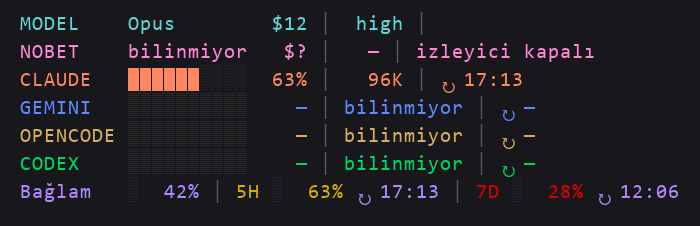

# Afu Claude Statusline

A colorful multi-row status bar for [Claude Code](https://claude.com/claude-code): model, cost per 1M tokens, effort, quota bars for Claude / Gemini / OpenCode / Codex, context usage with 5H / 7D reset times, plus a subagent panel.



Works standalone: rows for providers you don't use simply show `—`.

## Install (1 minute)

Requirements: Claude Code, Python 3, bash (Git Bash on Windows).

```bash
git clone https://github.com/pirncedark/afu-claude-statusline.git
cd afu-claude-statusline
bash install.sh        # Windows PowerShell: ./install.ps1
```

Restart Claude Code. The installer backs up existing files and only sets `statusLine` and `subagentStatusLine` in `~/.claude/settings.json`.

## Uninstall

Remove the `statusLine` and `subagentStatusLine` keys from `~/.claude/settings.json`.

## Optional environment variables

| Variable | Purpose |
|---|---|
| `AFUNOBET_DIR` | Folder of the optional AfuNöbet failover tool (enables the NOBET row data) |
| `AFUNOBET_MONITOR_STATUS` | Path to a custom `local_status.json` |

## Türkçe özet

Claude Code için renkli çok satırlı durum çubuğu. Kurulum: depoyu klonla, `bash install.sh` çalıştır, Claude Code'u yeniden başlat. Kullanmadığın sağlayıcı satırları `—` gösterir; ek kurulum gerekmez.

## License

MIT
